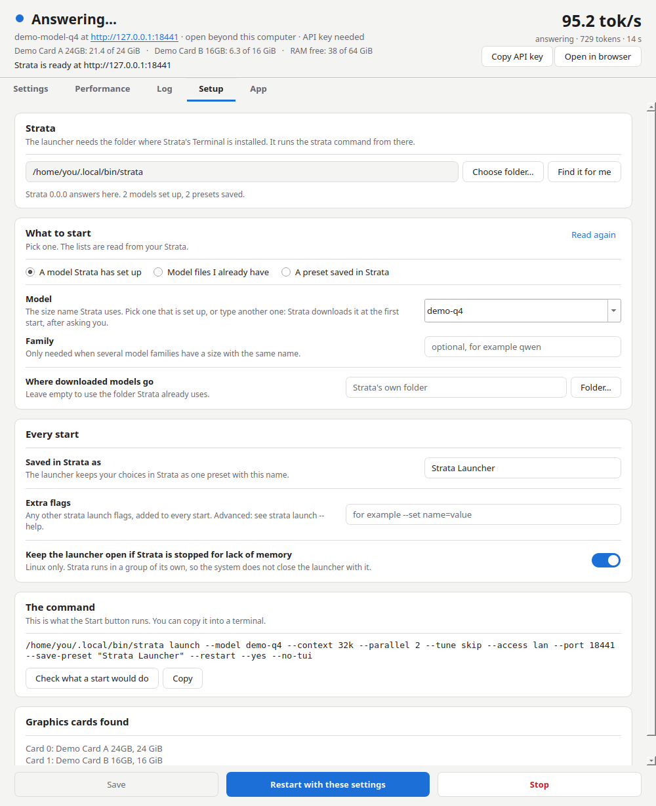
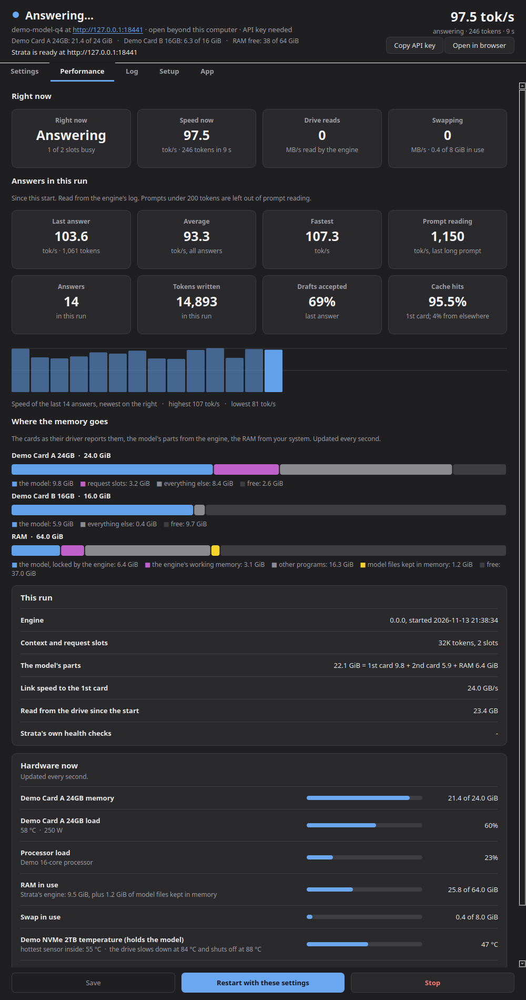
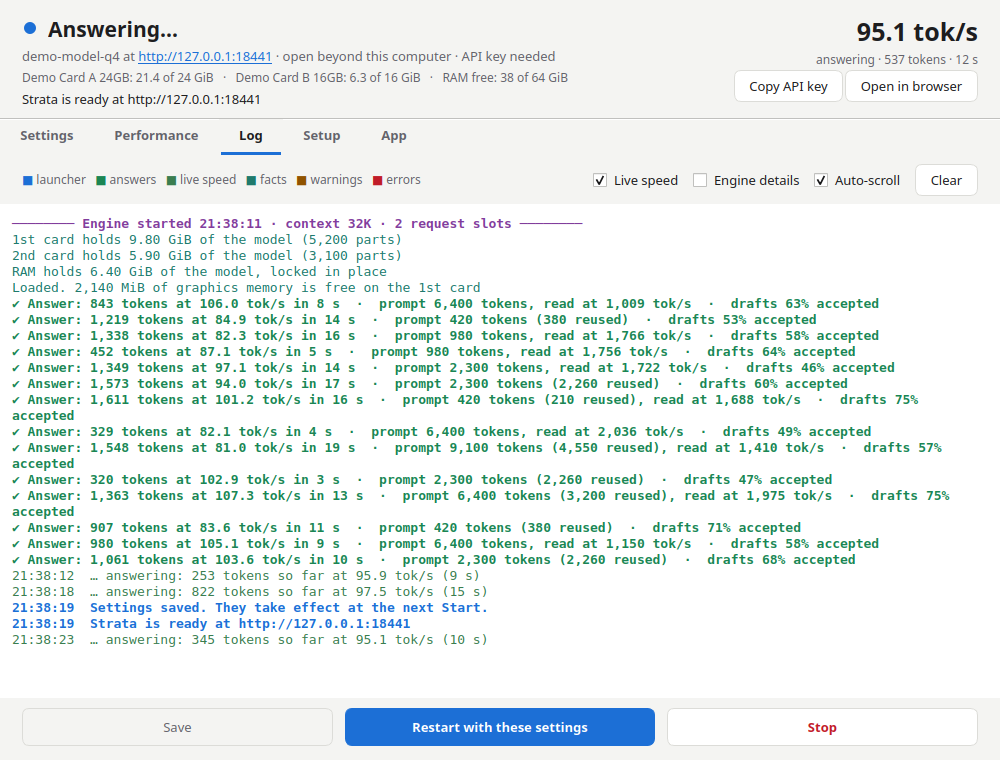
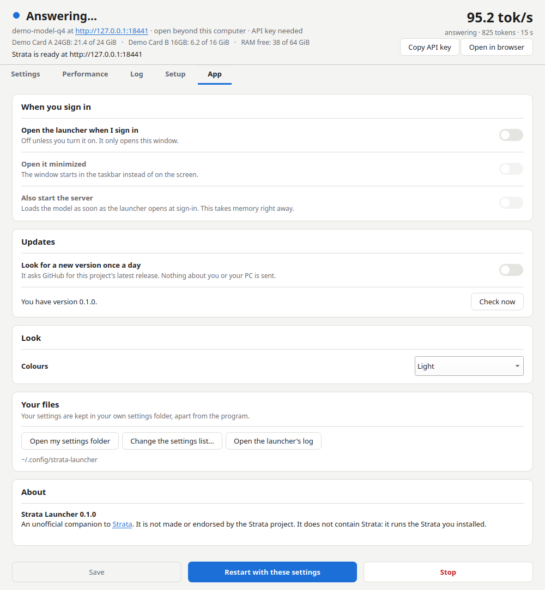

# Strata Launcher

A small desktop window for [Strata](https://github.com/Niko1221/Strata), the local AI server. You point it at your
Strata folder. It then helps you choose a model and its settings, starts and stops the server, and shows what the
server is doing. It runs on Windows and Linux.

**This is an unofficial companion.** It is not made or endorsed by the Strata project. It does not contain Strata:
it runs the `strata` command of the Strata you installed yourself.


## What it does

- **Settings** with **Save**, **Start** and **Stop**. Each setting is one `strata launch` flag, explained in a sentence.
- **Performance**, updated once a second: what the model is doing now and how fast, the speed of every answer, where
  the graphics memory and the RAM go, and hardware readings.
- **Log**: Strata's messages in plain words and in colour. The engine's own lines are hidden until you ask for them.
- **Setup**: where Strata is, which model or saved preset to start, and the exact command the Start button runs.
- **App**: open the launcher when you sign in, look for updates, light or dark colours.
- The server's address in the window is a link. One button copies the API key.
- Before a start it asks Strata for its plan. If the start would download a model, it asks you first.

The pictures on this page were made with a stand-in for Strata. Every name and number in them is made up.

## Install

You need Strata's **Terminal** first (the `strata` command). See
[Strata's install page](https://github.com/Niko1221/Strata/blob/main/docs/INSTALL.md#the-terminal).

### Windows

1. Open the [latest release](../../releases/latest) and download `StrataLauncher-…-x64.msi`.
2. Double-click it. It installs for you only and asks for no administrator rights. The launcher opens when it is done.
3. Later you find it in the Start menu as **Strata Launcher**.

The installer is not signed. Windows may show "Windows protected your PC" the first time: choose **More info**, then
**Run anyway**.

It installs into `%LOCALAPPDATA%\Programs\Strata Launcher` and adds one Start menu entry. Nothing else.

### Linux

1. Open the [latest release](../../releases/latest) and download `strata-launcher-…-linux-x86_64.tar.gz`.
2. Unpack it and run the installer. No `sudo` is needed:

```bash
tar -xzf strata-launcher-*-linux-x86_64.tar.gz
```

```bash
./strata-launcher-*-linux-x86_64/install.sh
```

3. Open **Strata Launcher** from your app menu, or run `strata-launcher`.

The download holds the ready-made program, so you do not need Python.

**From the source code instead** (needs Python 3.10 or newer; it downloads Qt, about 100 MB):

```bash
git clone https://github.com/OWNER/strata-launcher.git
```

```bash
./strata-launcher/install.sh
```

## First start: point it at Strata

The launcher looks for the `strata` command by itself: on your PATH, then in the folders Strata's own installers use
(`%LOCALAPPDATA%\Strata` on Windows, `~/.local/bin` and `~/.local/share/strata` on Linux).

If it does not find Strata, it asks **Where is Strata?** Choose the folder where Strata's Terminal is installed, the
one that has a `bin` folder with `strata` in it. You can change it later on the **Setup** tab.



Then, on the **Setup** tab:

1. **What to start.** Pick one:
   - *A model Strata has set up*: the list shows the models on your PC. You can also type another model name. Strata
     then downloads it at the first start, after the launcher asked you.
   - *Model files I already have*: a folder of model files or one `.gguf` file.
   - *A preset saved in Strata*: a preset you made with `strata launch`.
2. Press **Check what a start would do** if you want to see Strata's plan. Nothing is started or downloaded.
3. Go to **Settings**, change what you want, and press **Start**.

The launcher saves your choices in Strata as one preset, named "Strata Launcher" unless you change the name.

## The tabs

### Settings

Every setting left on **Strata's default** adds no flag, so Strata decides (or the preset you chose does).
**Save** stores your choices. **Start** saves them and starts the server. If the server is already running, the
button reads **Restart with these settings**. **Stop** unloads the model.

### Performance


- **Right now**: idle, reading the prompt, thinking or answering, with the live speed.
- **Answers in this run**: last, average and fastest speed, prompt reading speed, drafts accepted, cache hits, and a bar
  for each of the last 40 answers.
- **Where the memory goes**: one bar for each graphics card and one for the RAM.
- **Hardware now**: memory, load, temperature and power of the cards, processor load, RAM, swap. On Linux also the
  temperature of NVMe drives.

It also comes in dark:



### Log



Blue lines are the launcher's own messages, green lines are finished answers, yellow and red are warnings and errors.
Tick **Engine details** to see every line the engine writes. API keys are never shown or logged.

### App



## Open it when you sign in

On the **App** tab, turn on **Open the launcher when I sign in**. It is off unless you turn it on.

- **Open it minimized** keeps the window in the taskbar.
- **Also start the server** loads the model as soon as the launcher opens at sign-in.

How it is done, for you only and without administrator rights:

| System | What the switch writes |
| --- | --- |
| Windows | A value named "Strata Launcher" under `HKEY_CURRENT_USER\Software\Microsoft\Windows\CurrentVersion\Run`. Task Manager lists it under Startup apps. |
| Linux | The file `~/.config/autostart/strata-launcher.desktop`. |

## Make it yours

### Extra flags

On the **Setup** tab, **Extra flags** takes any other `strata launch` flags. They are added to every start. Example:

```
--set resident-experts=on
```

### Your own settings list

The settings the window shows are data, not code. The built-in list is
[`default_options.json`](src/strata_launcher/default_options.json). To change it, press **Change the settings list…**
on the **App** tab. That opens your own `options.json` in your settings folder. Close the launcher and open it again
after you change the file.

In your file:

- `settings`: a list. An entry with the key of a built-in setting replaces it. A new key adds a setting.
- `remove`: keys of built-in settings to hide.
- `address`: the address the launcher asks for live figures. `{port}` is the value of the setting with the key `port`.

Example: add a switch, give the port another default, and hide two settings.

```json
{
  "settings": [
    {
      "key": "low_ram",
      "group": "Speed and memory",
      "label": "Low-RAM mode",
      "help": "Keeps in RAM only the parts of the model that no graphics card holds.",
      "type": "switch",
      "default": true,
      "on": ["--set", "resident-experts=on"],
      "off": []
    },
    {
      "key": "port",
      "group": "Access",
      "label": "Port",
      "type": "number",
      "default": 9000,
      "min": 1024,
      "max": 65535,
      "flags": ["--port", "{value}"]
    }
  ],
  "remove": ["speed", "tune"]
}
```

Setting types:

| Type | Fields | What it adds to the command |
| --- | --- | --- |
| `choice` | `options` (a list of `[value, text shown]`), `flags`, optional `flags_for`, optional `"editable": true` | `flags` with `{value}` replaced. `flags_for` gives other flags for particular values. |
| `number` | `min`, `max`, `step`, `flags`, optional `"optional": true` | `flags` with `{value}` replaced. With `optional`, "Strata's default" adds nothing. |
| `switch` | `on`, `off` | The `on` flags or the `off` flags. |
| `text` | `flags`, optional `placeholder` | `flags` with `{value}` replaced. Empty adds nothing. |

A broken entry does not stop the launcher. It is left out, and the Log tab says what is wrong with it.

## Update

- **Windows**: the launcher looks for a new version once a day (you can turn this off on the App tab). When there is
  one, the App tab shows **Download and install**. It downloads the new installer from this project's GitHub
  releases, installs it over the old version and opens the launcher again. Your settings are kept. A running Strata
  server keeps running. You can also download the new `.msi` yourself and double-click it.
- **Linux**: the App tab tells you when there is a new version and opens the download page. Unpack the new download
  and run its `install.sh` again. From source: `git pull`, then `./install.sh`.

The update check is one web request to GitHub for this project's latest release. Nothing about you or your PC is sent.

## Uninstall

- **Windows**: Settings → Apps → Installed apps → Strata Launcher → Uninstall. This removes the program, the Start menu
  entry and the sign-in entry.
- **Linux**: run `./uninstall.sh` from the download or the source folder.

Your settings are kept, so a later install finds them again. To remove them too, delete the settings folder below
(Linux: `./uninstall.sh --settings`). Strata, its models and a running Strata server are never touched.

## Where your files are

| What | Windows | Linux |
| --- | --- | --- |
| Your settings (`config.json`, your `options.json`) | `%APPDATA%\Strata Launcher` | `~/.config/strata-launcher` |
| The launcher's own log | `%LOCALAPPDATA%\Strata Launcher\logs` | `~/.local/state/strata-launcher` |
| The program | `%LOCALAPPDATA%\Programs\Strata Launcher` | `~/.local/share/strata-launcher` |

Set `STRATA_LAUNCHER_CONFIG_DIR` to keep settings and log in a folder of your choice.

## Command line

On Linux, and from source on Windows:

```bash
strata-launcher --print     # the strata command for your saved settings
strata-launcher --start     # what the Start button does, without the window
strata-launcher --stop      # what the Stop button does
strata-launcher --status    # what Strata is serving now
```

The Windows program from the installer has no console, so these print nothing there.

## Limits

- **Not tested with a real Strata on Windows.** On Windows the launcher was tested end to end against a stand-in for
  Strata (install, first start, every tab, Start and Stop, sign-in switch, update, uninstall), on Windows Server 2025.
  Reading the memory of Strata's engine on Windows is written from Strata's documentation, not measured.
- The Windows installer was tested from an administrator account. It asks for no administrator rights by design, but
  an install from a standard account was not tested.
- Live figures need Strata's server to answer on `127.0.0.1` at the port you set. With an API key the launcher asks
  Strata for the key once and keeps it in memory only.
- Graphics cards are read with NVIDIA's `nvidia-smi` when it is installed. Without it (AMD, Intel) the window shows
  the one card Strata reports, and only while Strata runs.
- The plain sentences in the Log tab and the per-card split of the model follow the wording of Strata engine 0.1.x.
  A newer engine may get fewer plain sentences; its lines still show under **Engine details**.
- Prompts under 200 tokens are left out of "Prompt reading". Strata's own one-token health checks are not counted as
  answers.
- **Stop** runs `strata launch --stop`. If you run several Strata servers at once, check with Strata which one that stops.
- One window per person. There is no tray icon.
- The Windows installer is not signed.

## For developers

```bash
git clone https://github.com/OWNER/strata-launcher.git
cd strata-launcher
python -m venv .venv && . .venv/bin/activate      # Windows: .venv\Scripts\activate
pip install -e ".[dev]"
python -m strata_launcher                          # run from source
ruff check . && pytest                             # lint and tests
```

Nothing in the tests needs Strata, a model or a graphics card. They use the stand-in in
[`tools/fake_strata`](tools/fake_strata): a `strata` command that answers like Strata, a small server that pretends
to answer requests, and a stand-in `nvidia-smi`.

| Path | What it is |
| --- | --- |
| `src/strata_launcher/command.py` | Builds the `strata launch` command from the settings. |
| `src/strata_launcher/options.py`, `default_options.json` | The settings list and how your file is laid over it. |
| `src/strata_launcher/config.py` | Your saved choices, and bringing older files up to date. |
| `src/strata_launcher/strata.py` | Finding the `strata` command and reading what it prints. |
| `src/strata_launcher/enginelog.py`, `metrics.py` | Reading the engine log and the server's figures. |
| `src/strata_launcher/sampler.py`, `proc.py` | The once-a-second readings and every program the launcher starts. |
| `src/strata_launcher/autostart.py`, `updates.py` | Opening at sign-in, and the update check. |
| `src/strata_launcher/ui/` | The window (Qt, through PySide6). |
| `packaging/` | The PyInstaller recipe, the WiX installer and its test, the Linux download. |

**Try it without Strata:**

```bash
python tools/make_demo_config.py /tmp/demo-settings
STRATA_LAUNCHER_CONFIG_DIR=/tmp/demo-settings python -m strata_launcher
```

**The self-test** opens the real window, presses its real buttons (Save, Start three times, every tab, Stop twice, the
sign-in switch) and counts threads and programs before and after. It only runs against the stand-in:

```bash
STRATA_LAUNCHER_CONFIG_DIR=/tmp/demo-settings python -m strata_launcher --selftest
```

**Why the readings are built the way they are.** An earlier private version of this tool polled from a window timer.
The poll queued itself again and started hundreds of helper programs until the PC froze. So here one background thread
takes every reading on its own one-second clock, a reading starts no program, the graphics cards come from one
`nvidia-smi` that keeps running, the same kind of command never runs twice at once, and every program the launcher
starts is counted. The self-test fails if any of that stops being true.

**Build the downloads:**

```powershell
packaging\windows\build.ps1                                   # out\StrataLauncher-<version>-x64.msi (needs Python and the .NET SDK)
packaging\windows\test-installer.ps1 -Msi out\StrataLauncher-<version>-x64.msi
```

```bash
pip install . pyinstaller && packaging/linux/build.sh         # out/strata-launcher-<version>-linux-x86_64.tar.gz
```

**The pictures on this page:** `QT_QPA_PLATFORM=offscreen python tools/make_screenshots.py docs/screenshots`

**CI** (GitHub Actions): lint and tests on Linux and Windows, then the Windows installer is built with WiX, installed,
self-tested, upgraded and uninstalled, and the Linux download is built and self-tested.

**A release:** set the version in `src/strata_launcher/__init__.py`, commit, and push a tag `v<that version>`. The
release workflow tests, builds both downloads and publishes them with their checksums.

## Credits

- [Strata](https://github.com/Niko1221/Strata) is by Niko1221 and the Strata contributors (MIT License). This project
  only runs its `strata` command. It ships none of Strata's code or artwork.
- The window uses [Qt](https://www.qt.io) through [PySide6](https://doc.qt.io/qtforpython-6/) (LGPL v3) and
  [psutil](https://github.com/giampaolo/psutil) (BSD 3-Clause). The downloads are packaged with
  [PyInstaller](https://pyinstaller.org) and the [WiX Toolset](https://wixtoolset.org).
