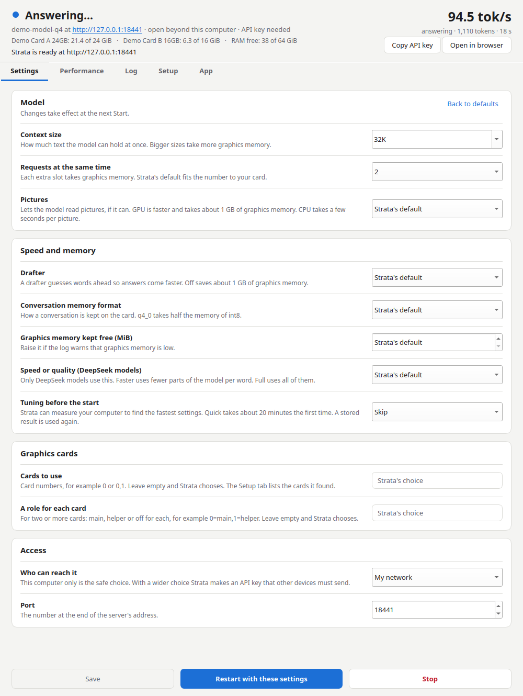
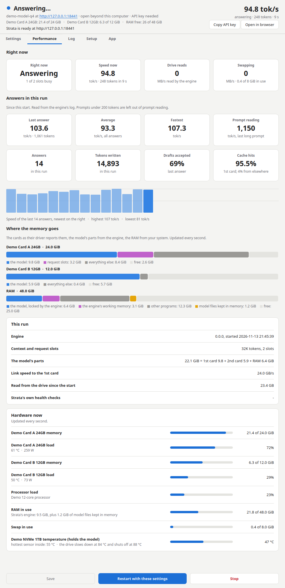

# Strata Launcher

[](https://github.com/borexola/strata-launcher/actions/workflows/ci.yml)

A small desktop window for [Strata](https://github.com/Niko1221/Strata), the local AI server. Point it at your
Strata folder. It helps you choose a model and its settings, starts and stops the server, and shows what the server
is doing. For Windows and Linux.

**Unofficial.** It is not made or endorsed by the Strata project, and it does not contain Strata. It runs the
`strata` command of the Strata you installed yourself.






The pictures use a stand-in for Strata. Every name and number in them is made up.

## What it does

- **Settings** with **Save**, **Start** and **Stop**. Each setting is one `strata launch` flag, explained in a sentence.
- **Performance**, once a second: what the model is doing and how fast, each answer's speed, where the memory goes.
- **Log**: Strata's messages in plain words and in colour. API keys are never shown.
- **Setup**: where Strata is, which model or saved preset to start, and the exact command Start runs.
- **App**: open at sign-in (off by default), update check, light or dark colours.
- **Strata updates**: it looks once a day for a newer Strata and can run Strata's own updater for you.
- It asks you before a start that would download a model, and before any update.

## Install

You need Strata's Terminal first (the `strata` command):
[how to install Strata](https://github.com/Niko1221/Strata/blob/main/docs/INSTALL.md#the-terminal).

**Windows:** download `StrataLauncher-…-x64.msi` from the [latest release](../../releases/latest) and double-click
it. It installs for you only and needs no administrator rights. The installer is not signed, so Windows may ask:
choose **More info**, then **Run anyway**.

**Linux:** download `strata-launcher-…-linux-x86_64.tar.gz` from the [latest release](../../releases/latest), then:

```bash
tar -xzf strata-launcher-*-linux-x86_64.tar.gz
```

```bash
./strata-launcher-*-linux-x86_64/install.sh
```

No `sudo` and no Python needed. Open **Strata Launcher** from your app menu.

**Linux from source** (needs Python 3.10 or newer):

```bash
git clone https://github.com/borexola/strata-launcher.git
```

```bash
./strata-launcher/install.sh
```

## First start

The launcher looks for `strata` by itself. If it does not find it, it asks **Where is Strata?** Choose the folder
where Strata's Terminal is installed (the one with a `bin` folder that holds `strata`).

On the **Setup** tab pick what to start: a model Strata has set up, model files you already have, or a preset saved
in Strata. Then change what you want on **Settings** and press **Start**.

A setting left on **Strata's default** adds no flag, so Strata decides.

## Update and uninstall

- **Update Strata itself:** on the Setup tab, **Check for Strata updates** asks Strata's own updater
  (`strata update --check`). If there is a newer engine, **Update Strata…** runs `strata update` after you say yes.
  Strata downloads from its own signed feed and keeps the old version if the new one fails its test start. A loaded
  model is only stopped if you agree, and Strata starts it again afterwards.
- **Update the launcher, Windows:** the App tab shows **Download and install** when there is a new version. Your settings stay.
- **Update the launcher, Linux:** download the new version and run its `install.sh` again.
- **Uninstall, Windows:** Settings → Apps → Strata Launcher → Uninstall.
- **Uninstall, Linux:** `./uninstall.sh` (add `--settings` to remove your settings too).

The launcher's own update check is one request to GitHub for this project's latest release. Nothing about you or
your PC is sent. Both daily checks can be switched off on the App tab. Strata, its models and a running server are never touched.

## Where your files are

| What | Windows | Linux |
| --- | --- | --- |
| Your settings | `%APPDATA%\Strata Launcher` | `~/.config/strata-launcher` |
| The launcher's log | `%LOCALAPPDATA%\Strata Launcher\logs` | `~/.local/state/strata-launcher` |
| The program | `%LOCALAPPDATA%\Programs\Strata Launcher` | `~/.local/share/strata-launcher` |

## Make it yours

**Extra flags** on the Setup tab are added to every start. The list of settings itself is data: you can add, change
or hide settings in your own `options.json`. See [docs/CUSTOMIZE.md](docs/CUSTOMIZE.md).

## Limits

- On Windows it was tested end to end against a stand-in for Strata, not with a real Strata.
- Updating Strata was tested against the stand-in. With a real Strata only the check was tried, not an update.
- Graphics cards are read with NVIDIA's `nvidia-smi`. Without it the window shows the one card Strata reports, and
  only while Strata runs.
- The plain sentences in the Log follow the wording of Strata engine 0.1.x. Other lines still show under
  **Engine details**.
- **Stop** runs `strata launch --stop`. One window per person. No tray icon.

## More

- [Working on the code, tests and builds](docs/DEVELOPMENT.md)
- License: MIT. See [LICENSE](LICENSE).
- [Strata](https://github.com/Niko1221/Strata) is by Niko1221 and the Strata contributors (MIT). This project ships
  none of Strata's code or artwork. The window uses Qt through PySide6 (LGPL v3) and psutil (BSD).
